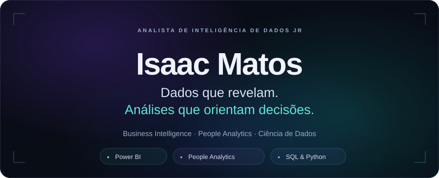
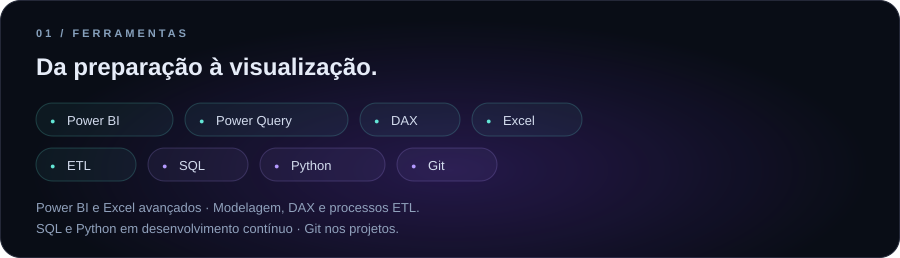
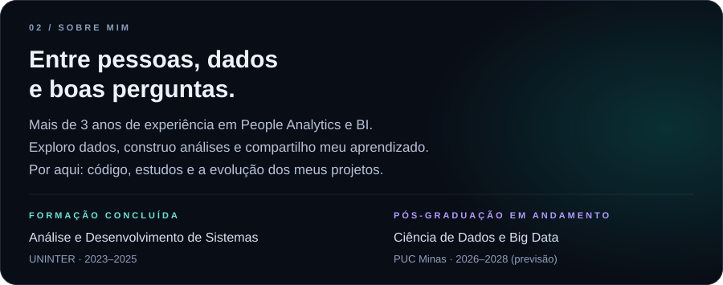
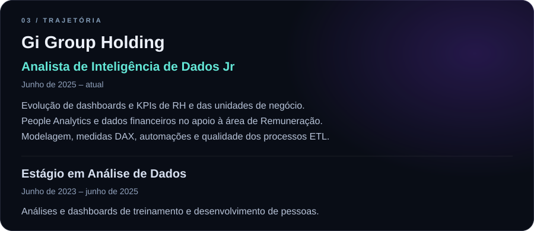
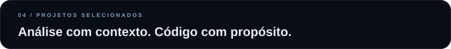
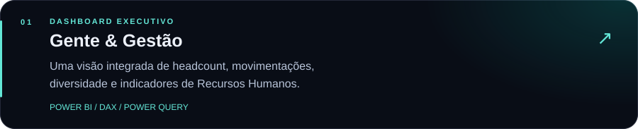
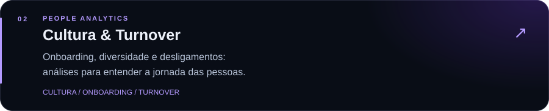
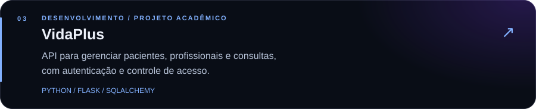
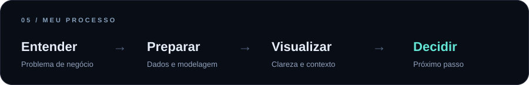

<!-- Perfil de Isaac Matos. Elementos visuais locais em assets/readme/. -->

Os indicadores dos cases de People Analytics foram alterados e não representam dados reais de empresas.

<a href="https://www.linkedin.com/in/isaac-matos-38995a21b/">LinkedIn</a> &nbsp; · &nbsp; <a href="https://github.com/ZhackMorr/portifolio-pessoal-isaacmoraes">Portfólio</a> &nbsp; · &nbsp; <a href="mailto:isaacmatosdemoraes399@gmail.com">E-mail</a>

